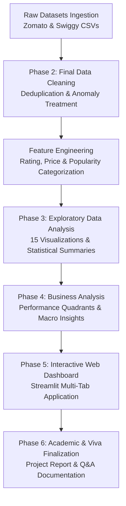

# Zomato vs Swiggy: Restaurant Rating & Performance Analysis

A comprehensive, end-to-end data analytics project examining customer ratings, pricing models, customer engagement, and operational dynamics across India's two premier food-tech ecosystems: **Zomato** and **Swiggy**.

---

## 1. Project Overview
In India's rapidly growing food service and hyper-local delivery economy, consumer dining choices and restaurant profitability are heavily governed by digital rating algorithms, pricing strategies, and delivery fulfillment speeds. This project performs an end-to-end empirical comparison between **55,568 Zomato restaurants across 99 cities** and **8,680 Swiggy restaurants across 9 metropolitan hubs**, culminating in an interactive Streamlit analytics dashboard.

---

## 2. Problem Statement
Food-tech aggregators connect millions of hungry consumers to hundreds of thousands of commercial kitchens. However, restaurant owners and business analysts face key strategic questions:
- How do customer rating distributions differ between dine-out destination apps (Zomato) and doorstep delivery services (Swiggy)?
- Does higher menu pricing correlate with higher or lower customer satisfaction?
- How severely does delivery latency depress customer ratings?
- Which operational cuisines and metropolitan markets drive peak customer engagement?
- How can restaurants be categorized into actionable performance tiers to guide marketing spend and menu re-engineering?

---

## 3. Objectives
1. **Clean & Standardize** disparate restaurant catalogs, resolving crawlers' duplicate records, artificial zero ratings, and malformed strings.
2. **Perform Exploratory Data Analysis (EDA)** to understand the statistical distributions of ratings, prices, feedback volume, and fulfillment durations.
3. **Compare Platforms Descriptively** across pricing architectures, rating tiers, and like-for-like performance in 9 overlapping metropolitan markets.
4. **Develop a Business Performance Matrix** (BCG-style framework) segmenting venues into *Star Performers*, *Rising Restaurants*, *Needs Improvement*, and *Low Visibility*.
5. **Build an Interactive Web Dashboard** in Streamlit with real-time multi-dimensional slicers for stakeholders and academic viva presentation.

---

## 4. Dataset Description

| Attribute | Zomato Dataset (`zomato_restaurants_in_India.csv`) | Swiggy Dataset (`swiggy.csv`) |
| :--- | :--- | :--- |
| **Raw Records** | 211,944 rows, 26 columns | 8,680 rows, 10 columns |
| **Cleaned Distinct Venues**| 55,568 unique restaurants | 8,680 unique restaurants |
| **Geographic Coverage** | 99 Indian Cities (Metro, Tier-1, Tier-2, Tier-3) | 9 Major Metros (Bangalore, Mumbai, Delhi, etc.) |
| **Core Focus** | Dine-out discovery, lounges, cafes, and delivery | Quick doorstep meal ordering |
| **Customer Feedback** | Exact continuous user votes (0 to 42,539) | Discrete bucketed reviews (20 to 10,000) |
| **Fulfillment Metrics** | Binary delivery availability flag (`has_online_delivery`)| Quantitative delivery time (`delivery_time_mins`)|
| **Delivery Fee Data** | Not available in source data | Not available in source data |

---

## 5. Tools & Technologies
- **Programming Language:** Python 3.11+
- **Data Manipulation & Cleaning:** Pandas, NumPy
- **Data Visualization & Charting:** Plotly Express, Plotly Graph Objects, Matplotlib, Seaborn
- **Interactive Web Dashboard:** Streamlit
- **Code Structuring & Linting:** PEP-8 Compliant Python Modules

---

## 6. Project Workflow



---

## 7. Data Cleaning Methodology
- **Deduplication:**
  - *Zomato:* Removed 151,527 exact duplicate rows across all 26 columns. Identified and resolved 4,849 multi-category scrape duplicates for identical restaurant IDs (`res_id`), prioritizing delivery-enabled records. Final cleaned Zomato: 55,568 distinct restaurant entities.
  - *Swiggy:* Verified 0 duplicate rows; retained all 8,680 records.
- **Handling Artificial Numerical Zeros:**
  - In Zomato, 23,478 raw entries had `aggregate_rating == 0.0` paired with `rating_text == 'Not rated'`. These were converted to `np.nan` (unrated). In the deduplicated dataset, 10,058 unrated venues are clearly distinguished from rated venues, preventing severe left-tail distortion.
  - In Zomato, 2,077 raw rows had `average_cost_for_two == 0`; mapped to `np.nan`.
  - In Swiggy, 5 raw rows had `Price == 0.0`; mapped to `np.nan`.
- **Anomaly Corrections:**
  - Converted negative vote counts in Zomato (`-18`, `-3`) to `np.nan`.
- **Text Standardization:**
  - Cleaned Python stringified lists in `establishment` (`['Casual Dining']` → `Casual Dining`) and `highlights`.
  - Standardized cuisine strings with comma-space delimiters.

---

## 8. Feature Engineering
Three standardized derived features were engineered across both datasets:
1. **`rating_category`**:
   - `Excellent` (Rating $\ge$ 4.5)
   - `Very Good` (4.0 $\le$ Rating < 4.5)
   - `Good` (3.5 $\le$ Rating < 4.0)
   - `Average` (2.5 $\le$ Rating < 3.5)
   - `Poor` (Rating < 2.5)
   - `Unrated` (`NaN`)
2. **`price_category`**:
   - `Budget` (Cost $\le$ ₹300)
   - `Mid-Range` (₹301 – ₹700)
   - `Premium` (₹701 – ₹1500)
   - `Fine Dining` (Cost > ₹1500)
3. **`popularity_category`**:
   - `Low` (Votes/Reviews $\le$ 50)
   - `Moderate` (51 – 250)
   - `High` (251 – 1,000)
   - `Very High` (> 1,000)

---

## 9. Exploratory Data Analysis (EDA) Highlights
15 standalone publication-quality charts were generated in `outputs/charts/`:
- **Rating Distributions:** Zomato mean rating is 3.61 (median 3.70); Swiggy mean rating is 3.66 (median 3.90).
- **Price vs Rating:** Higher price tiers systematically achieve higher customer ratings (Premium: 4.05 vs Budget: 3.58).
- **Delivery Availability:** Zomato restaurants with active online delivery achieve a 0.17 rating premium (3.72 vs 3.55) over non-delivery venues.
- **Delivery Time Decay:** On Swiggy, delivery time is negatively correlated with ratings ($r = -0.15$). Orders under 30 minutes average 4.12 ★, while orders exceeding 60 minutes drop to 3.58 ★.
- **Top Cuisines:** North Indian, Chinese, Fast Food, and Biryani dominate both dine-in and delivery catalogs nationwide.

---

## 10. Business Performance Matrix (Quadrant Analysis)

Restaurants were classified into four strategic quadrants based on rating ($\ge 4.0$) and engagement volume (Zomato median: 50 votes; Swiggy median: 80 reviews):

| Performance Quadrant | Zomato Venues | Swiggy Venues | Strategic Role |
| :--- | :--- | :--- | :--- |
| **Star Performers** (High Rating, High Engagement) | 12,060 (21.7%) | 2,439 (28.1%) | Flagship partner anchors driving platform brand equity and retention. |
| **Rising Restaurants** (High Rating, Low Engagement) | 501 (0.9%) | 1,566 (18.0%) | Boutique high-potential kitchens requiring algorithmic discovery boost. |
| **Needs Improvement** (Lower Rating, High Engagement) | 12,709 (22.9%) | 3,816 (44.0%) | High-volume kitchens suffering from consistency or packaging deficits. |
| **Low Visibility** (Lower Rating, Low Engagement) | 20,240 (36.4%) | 859 (9.9%) | Underperforming long-tail requiring culinary overhaul or delisting. |
| **Unrated / Pipeline** | 10,058 (18.1%) | 0 (0.0%) | Newly onboarded venues requiring first-bite review acceleration. |

---

## 11. Dashboard Features (`app.py`)
Built with Streamlit & Plotly, the dashboard includes:
- **Executive Overview:** 5 live KPI cards, interactive rating distribution overlay, and platform composition donut.
- **Rating Analysis:** Rating category tier comparisons, interactive scatter plot (log scale), and top 10 rated restaurants.
- **Price & Cuisine Analysis:** Price tier boxplots, top 15 cuisines horizontal bars, and cuisine rating scorecard.
- **Location Analysis:** City-level restaurant density, average rating rankings, and full interactive city scorecard.
- **Zomato vs Swiggy:** Side-by-side benchmarking on ratings, prices, feedback, and 9 common metro markets.
- **Dynamic Slicers:** Real-time multi-select filtering by Platform, City, Rating Tier, Price Tier, and Cuisine.

---

## 12. Key Findings
1. **The 45-Minute Delivery Ceiling:** Swiggy orders delivered under 30 minutes average 4.12 ★, whereas orders taking over 60 minutes plunge to 3.58 ★. Every 15 minutes of transit delay reduces customer ratings by ~0.18 points.
2. **The Delivery Rating Dividend:** Offering online delivery on Zomato is associated with a 0.17 higher rating (3.72 vs 3.55) and higher review velocity.
3. **Bangalore is the Culinary Capital:** Bangalore achieves the highest average ratings across both platforms (3.94 Zomato, 3.91 Swiggy).
4. **Hyderabad Leads Engagement:** Hyderabad consumers review at nearly double the national rate (Swiggy mean: 307.2 reviews vs 156.6 national average).
5. **Kolkata Logistics Friction:** Kolkata records India's highest average delivery duration (67.8 minutes vs 54.0 national average).
6. **Price Shields Satisfaction:** Premium and fine dining venues average higher ratings (4.05 – 4.25) than budget venues (3.52 – 3.65).
7. **Biryani Power-Law:** Biryani represents the largest dedicated single-dish delivery anchor in urban India.

---

## 13. Practical Business Recommendations
1. **Enforce a 12-Minute Kitchen Dispatch SLA:** Kitchens must streamline prep to hand over food to delivery partners within 10–12 minutes to beat the 45-minute delivery threshold.
2. **Promote the 'Rising Restaurant' Segment:** Platforms should programmatically surface high-rating, low-review boutique kitchens in curated carousels.
3. **Menu Pruning for 'Needs Improvement' Venues:** High-volume kitchens with sub-4.0 ratings should prune the bottom 20% of complex, slow-to-pack menu items.
4. **Deploy Hyperlocal Cloud Kitchen Pods:** In traffic-strained cities like Kolkata, aggregators should co-locate cloud kitchen pods near residential clusters.
5. **Incentivize Cold-Start Reviews:** Platforms should award bonus loyalty points to diners reviewing newly onboarded, unrated restaurants.

---

## 14. Project Limitations
- **Delivery Fee Omission:** Neither raw dataset contains delivery fee data; this was omitted without synthetic data fabrication.
- **Delivery Duration Metric Scope:** Present in Swiggy (minutes) but absent in Zomato (only binary delivery availability flag).
- **Sampling Heterogeneity:** Zomato covers 99 cities including dine-in destinations, while Swiggy covers 9 metro delivery hubs. Comparisons are descriptive benchmarks rather than absolute direct competition.

---

## 15. How to Run the Project

### Prerequisites
Ensure Python 3.10+ is installed on your system.

### Installation
1. Clone the repository or navigate to the project directory:
   ```bash
   cd "Rating Analysis"
   ```
2. Install the required dependencies:
   ```bash
   pip install -r requirements.txt
   ```

### Execution Steps
1. **Run Data Cleaning (Phase 2):**
   ```bash
   python notebooks/clean_data.py
   ```
2. **Run Exploratory Data Analysis (Phase 3):**
   ```bash
   python notebooks/rating_analysis.py
   ```
3. **Run Business Analysis (Phase 4):**
   ```bash
   python notebooks/business_analysis.py
   ```
4. **Launch the Interactive Streamlit Dashboard (Phase 5):**
   ```bash
   streamlit run app.py
   ```
   Open your browser at `http://localhost:8501`.

---

## 16. Future Scope
- **NLP Sentiment Mining on Customer Reviews:** Scrape and parse textual review comments using VADER or Transformer models to detect specific dish complaints.
- **Predictive Rating Regression:** Train XGBoost and Random Forest models to predict a restaurant's rating based on location, price, cuisine mix, and delivery speed.
- **Dynamic Geospatial Clustering:** Leverage restaurant latitude and longitude coordinates in Zomato to perform DBSCAN density clustering for kitchen site selection.
